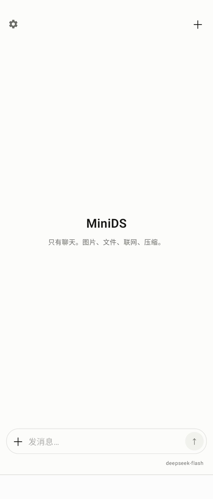

# MiniDS

一个极简的安卓聊天客户端，直接调用 DeepSeek 官方 API。

> 非官方项目，与 DeepSeek（深度求索）无关，仅使用其公开 API。
> 本项目的代码由 AI 生成；应用图标由 Gemini 生成。

<p align="center">
  
</p>

## 为什么做这个

2026 年 11 月 16 日起，DeepSeek App 与网页版开始限制免费用户的使用额度：
长对话、每日用量、单次输入长度同时收紧，抵达上限便会收到

> 你好，请等会儿再来吧
> 服务器繁忙，使用额度已达上限

需次日凌晨恢复额度。这次限额针对的是 App / 网页端，**API 不受影响**。

MiniDS 因此只做一件事：把对话直接放到官方 API 上——用自己的 API Key、
按量计费，不再受 C 端每日额度的约束（API 有自己的速率与计费规则）。

## 截图

<p align="center">
  
</p>

## 下载安装

| 版本 | 适合 | 变化 |
| --- | --- | --- |
| [**v1.1**](https://github.com/nodcharlotte/minids/releases/download/v1.1/MiniDS-1.1.apk) | 想在电脑上接着聊 | 电脑访问；图片多选；竖拍照片方向修正 |
| [v1.0](https://github.com/nodcharlotte/minids/releases/download/v1.0/MiniDS-1.0.apk) | 只要手机端 | 更简单，没有局域网服务 |

- 两版签名相同，可直接覆盖升级
- 安装时需允许「未知来源」
- 首次打开在设置里填入 **DeepSeek 官方 API Key**

SHA-256：

```
1.0  E8127646AEFD4ED54A46FA26AEB135CF21B35F342BFEC9D545768B43EE593F99
1.1  007359D6E248FB35E3BCDAE835B8397CFDA70307C3691E9E30095DFAD67A100E
```

## 功能

- 流式对话（SSE 打字机效果），Markdown 渲染（代码块、加粗、列表、引用）
- **＋** 菜单只有三项：上传图片、上传文件、压缩会话
- **图片可一次多选（1.1）**：按选择顺序上传，单张失败不影响其它
- **竖拍照片不再横躺（1.1）**：按 EXIF 方向把像素转正后再上传
- 联网搜索开关：模型自行判断是否搜索，回答附「参考来源」
- 深度思考开关：开启后低强度思考，过程默认折叠，可展开
- 设置只有：API Key、上下文长度滑块（2K–1M）、深度思考、联网搜索、外观（浅色 / 近黑深色）
- 单会话：右上角「＋」直接替换当前会话；会话落盘，重开还在
- 点自己的消息可原地编辑并重发，该条之后的内容会清空重来
- 压缩会话：菜单里显示「共 N 轮会话」；超过 10 轮只把更早的并入摘要，10 轮以内全部并入
- **带上当前时间**：每次请求把本机日期、时间与时区塞进提示词，模型不会瞎编「今天是几号」
- **电脑访问（1.1）**：同一 Wi‑Fi 下，用电脑浏览器打开手机上显示的地址继续聊；
  手机需要保持前台（前台服务维持连接），关掉开关即停止；
  网页端正文列宽固定 880px，两侧留白也可滚轮滚动

## 隐私

- API Key 用 Android Keystore 中的 AES-256 密钥加密后保存，密钥不可导出；设置关闭后不再回显
- `allowBackup=false`，Key 不会随系统备份离开设备
- 除 `api.deepseek.com` 外不访问任何服务器，无统计、无第三方 SDK
- 1.1 的「电脑访问」会在手机上开一个**局域网 HTTP 服务**，只对同一网段可见，
  用于电脑浏览器访问；开关关闭即停止，不经过任何第三方服务器

## 技术栈

Kotlin + Jetpack Compose (Material3) + OkHttp + kotlinx.serialization + DataStore。

1.1 增加 NanoHTTPD，在手机本地提供电脑端使用的网页界面。

需要 **DeepSeek 官方 API Key**。模型固定 `deepseek-flash`：官方目前唯一支持图片输入的型号。

## 目录

```
app/src/main/java/com/minids/
├── MainActivity.kt
├── ChatViewModel.kt          # 状态、发送、裁剪、压缩、编辑重发
├── WebService.kt             # 电脑访问的前台服务（1.1）
├── data/                     # 模型、设置（加密存储）、会话 JSON
├── net/DeepSeekApi.kt        # Files 上传、SSE 对话、余额查询
├── net/WebServer.kt          # 局域网 HTTP 服务（1.1）
├── ui/ChatScreen.kt          # 聊天页、输入栏、思考折叠、来源列表
├── ui/Sheets.kt              # 设置面板、＋ 菜单、自绘开关
├── ui/Markdown.kt            # 轻量 Markdown 渲染
├── ui/Theme.kt               # 浅色 / 近黑深色
└── util/                     # 图片压缩上传、Key 加解密、局域网地址（1.1）
```

`app/src/main/assets/web/` 是电脑访问用的网页界面。

## 构建

需要 JDK 17 与 Android SDK（compileSdk 35），用 Android Studio 打开本目录即可。

本仓库**不含 Gradle wrapper**（没有 `gradlew` / `gradle-wrapper.jar`），所以不要用
`./gradlew`，Studio 会使用自带的 Gradle。

release 构建需要仓库外的 `keystore.properties` 与 `.jks` 文件；没有它们时
`assembleRelease` 产出未签名包，`assembleDebug` 不受影响。

## 已知取舍

- 图片上传前压到长边 1300px、JPEG 88；官方会再缩放，单图最多计 1024 token
- PDF/Word/PPT 用 `text_recognition`（只取文字），表格类与文本用 `user_data`
- 图片和文件多轮复用只存 `file_id`，但每轮请求仍会重复计费其输入 token（官方行为）
- token 预算是本地估算（中文按 0.9、英文按 0.3），仅用于裁剪，不影响计费
- 压缩会调用一次非思考模型生成摘要，产生少量费用
- 电脑访问期间手机要保持前台，息屏会被系统限制；1.1 用前台服务 + 唤醒锁缓解

## 图标

应用图标由 AI 图像生成工具（Gemini）生成。

## 许可

[MIT](LICENSE)

## API 依据

- https://api-docs.deepseek.com/guides/vision
- https://api-docs.deepseek.com/guides/files_api
- https://api-docs.deepseek.com/guides/document_parsing
- https://api-docs.deepseek.com/guides/web_tools
- https://api-docs.deepseek.com/api/get-user-balance
